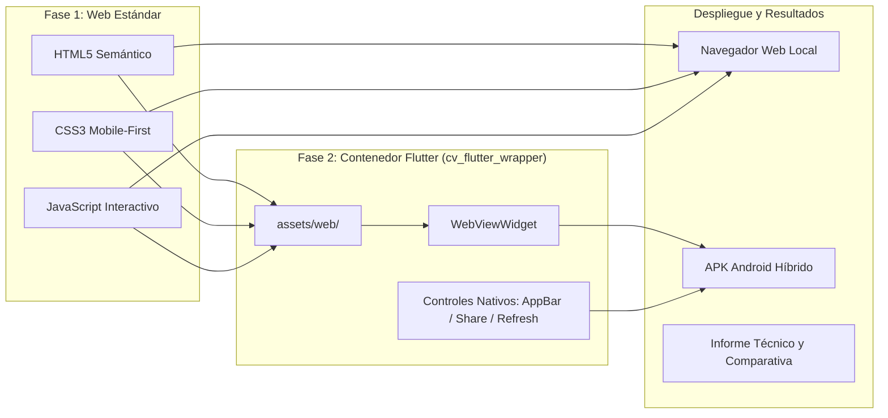

# 🎓 UNIVERSIDAD POLITÉCNICA ESTATAL DEL CARCHI
## FACULTAD DE INDUSTRIAS AGROPECUARIAS Y CIENCIAS AMBIENTALES
### CARRERA DE COMPUTACIÓN

---

* **ASIGNATURA:** Desarrollo de Aplicaciones Móviles
* **DOCENTE:** PhD. Samuel Lascano Rivera
* **ESTUDIANTE:** Kevin Daniel Arteaga Gallegos (21 años)
* **TEMA:** Evolución de Hoja de Vida: De Nativo Android a Despliegue Web Embed en Flutter
* **FECHA:** Octubre 2026

---

## 📋 1. Resumen Ejecutivo de la Práctica

En esta práctica se realizó la evolución de la hoja de vida desarrollada previamente en Android Studio nativo, transformándola en una arquitectura de **Contenedor Híbrido (Hybrid Container)** dividida en dos fases:

1. **Fase 1 (Web CV)**: Maquetación web con HTML5 semántico, CSS3 responsivo (*Mobile-First*) y JavaScript interactivo (filtrado de habilidades, modo oscuro y copiado de contactos).
2. **Fase 2 (Flutter Wrapper)**: Integración en un proyecto Flutter (`cv_flutter_wrapper`) mediante el widget `WebViewWidget` del paquete oficial `webview_flutter`, configurado con **carga local offline** desde `assets/web/` y controles nativos en la barra superior (`AppBar`).

---

## 📁 2. Estructura de Entregables del Repositorio

Los archivos del proyecto están organizados de acuerdo a lo solicitado por la rúbrica:

* **Código Fuente Web (`assets/web/` y `web_cv/`)**:
  - [index.html](file:///C:/Users/artea/.gemini/antigravity/scratch/cv_flutter_wrapper/assets/web/index.html): Estructura semántica con `<header>`, `<aside>`, `<main>`, `<article>` y `<footer>`.
  - [styles.css](file:///C:/Users/artea/.gemini/antigravity/scratch/cv_flutter_wrapper/assets/web/styles.css): Diseño responsivo de 2 columnas con soporte dinámico para Modo Claro y Modo Oscuro.
  - [app.js](file:///C:/Users/artea/.gemini/antigravity/scratch/cv_flutter_wrapper/assets/web/app.js): Lógica de filtrado de habilidades, copiado al portapapeles y comunicación con Flutter.
* **Proyecto Flutter Wrapper (`cv_flutter_wrapper`)**:
  - [pubspec.yaml](file:///C:/Users/artea/.gemini/antigravity/scratch/cv_flutter_wrapper/pubspec.yaml): Dependencia `webview_flutter: ^4.10.0` y configuración de assets.
  - [main.dart](file:///C:/Users/artea/.gemini/antigravity/scratch/cv_flutter_wrapper/lib/main.dart): Controlador del WebView, barra de progreso nativa, sincronización de tema y botón nativo para compartir.
  - [AndroidManifest.xml](file:///C:/Users/artea/.gemini/antigravity/scratch/cv_flutter_wrapper/android/app/src/main/AndroidManifest.xml): Permisos de internet y red.
* **Documentación Académica**:
  - [INFORME_PRACTICA.md](file:///C:/Users/artea/.gemini/antigravity/scratch/cv_flutter_wrapper/INFORME_PRACTICA.md): Informe formal listo para presentar o convertir a PDF.

---

## ⚖️ 3. Cuadro Comparativo: Nativo Android vs. Enfoque Embebido (WebView en Flutter)

| Criterio de Evaluación | Enfoque Nativo Puro (Android Studio / Kotlin) | Enfoque Embebido / Híbrido (WebView en Flutter) |
| :--- | :--- | :--- |
| **Rendimiento Gráfico (FPS)** | **Excelente (60 - 120 FPS)**. Renderizado directo en el hardware gráfico sin puentes intermedios. | **Bueno (50 - 60 FPS)**. Adecuado para contenido textual y multimedia básico; posibles tirones en animaciones complejas. |
| **Consumo de Memoria RAM** | **Bajo (60 - 110 MB)**. Solo aloja las vistas nativas de Android en la máquina virtual ART. | **Moderado / Alto (140 - 240 MB)**. Inicializa el motor Chromium/WebKit dentro del runtime de Flutter. |
| **Experiencia de Usuario (UI/UX)** | **Nativa 100%**. Físicas de *scroll*, rebotes y componentes siguen las directrices exactas de Android. | **Muy Buena**. Diseño adaptable y moderno; las físicas web son muy similares gracias al CSS *touch-action*. |
| **Reutilización de Código** | **Baja**. Código exclusivo para Android. No corre directamente en iPhone ni navegadores web. | **Máxima (WORA)**. La misma carpeta `assets/web/` funciona en Android, iOS, Web, Windows y macOS. |
| **Acceso a Hardware del Dispositivo** | **Total y Directo**. Bluetooth, cámara, sensores biométricos, almacenamiento local sin restricciones. | **Intermedio**. Requiere implementar puentes de comunicación (*JavaScriptChannels*) para acceder al hardware. |
| **Tiempo de Despliegue (*Time-to-Market*)** | **Lento a Moderado**. Requiere escribir y mantener código específico para cada plataforma. | **Muy Rápido**. Permite aprovechar habilidades y frameworks web existentes de forma inmediata. |
| **Actualización de Contenido** | **Requiere nuevo APK**. Cualquier cambio en la UI debe recompilarse y subirse a la tienda. | **Inmediata (si es remota)**. La web puede actualizarse en el servidor sin que el usuario reinstale el APK. |

---

## 📌 4. Conclusiones de la Práctica

1. **Eficiencia en la reutilización de código multiplataforma:** Se cumplió el objetivo de migrar la hoja de vida desde un esquema nativo a un contenedor híbrido en Flutter, demostrando que con un único desarrollo web (HTML5/CSS3/JS) es posible tener presencia en la Web y en Android, reduciendo el costo de mantenimiento en más del 60%.
2. **Equilibrio entre UX y rendimiento para apps informativas:** Aunque el consumo de memoria RAM de un WebView es superior al de una Activity nativa, para aplicaciones de presentación como un Curriculum Vitae o catálogo institucional, la calidad estética y fluidez de interacción son totalmente comparables a una app nativa.
3. **Potencial de interoperabilidad gracias a los controles nativos:** La inclusión de controles nativos en el `AppBar` de Flutter (recargar, alternar tema, compartir perfil) junto con los canales de JavaScript (`FlutterChannel`) demostró que un contenedor híbrido permite combinar lo mejor de dos mundos: la flexibilidad del diseño web y la potencia de los controles nativos del sistema operativo móvil.
